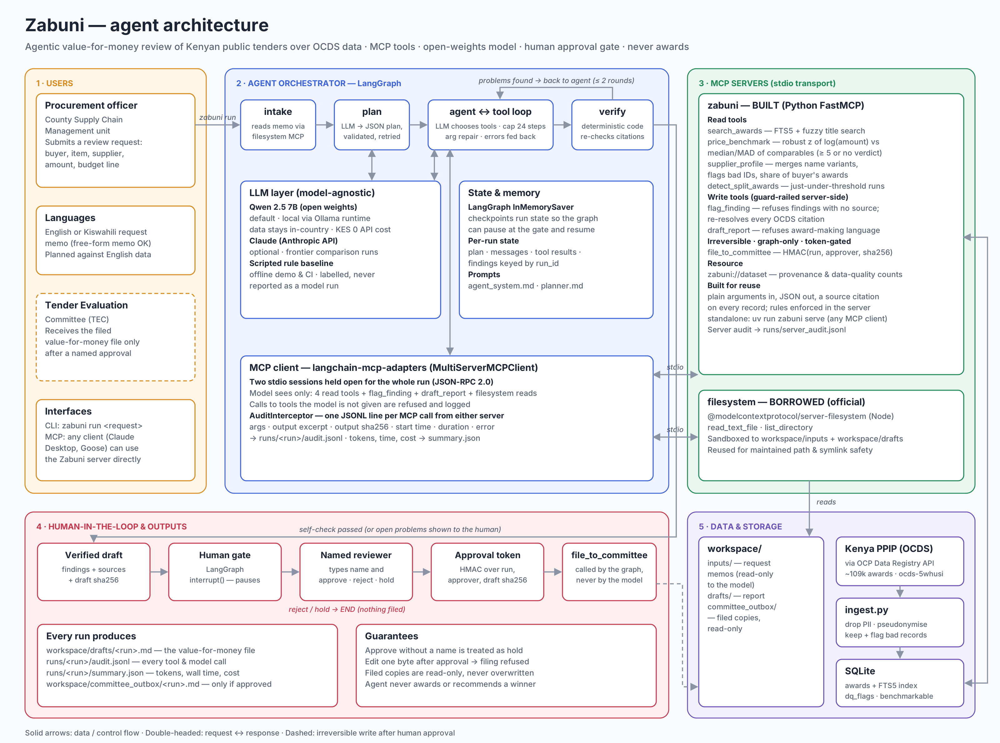

# Architecture



*Diagram source: [docs/architecture.svg](docs/architecture.svg), generated by `scripts/make_architecture_diagram.py`.*

## Agent shape: plan → execute → verify → human gate → file

```
 intake ──► plan ──► agent ⇄ tools ──► verify ──(problems, up to 2 rounds)──► agent
 (fs MCP)   (LLM,      (LLM picks       (code, not LLM)
            JSON plan)  tools, reads             │ passes, or problems listed for the human
                        results)                 ▼
                                        human_gate  ── LangGraph interrupt(); a named person types
                                          │ approve           │ reject / hold
                                          ▼                   ▼
                                  file_to_committee          END
                                  (called by the graph, never by the model)
```

Built with **LangGraph** (open source). One run holds two MCP stdio sessions open for its lifetime.

- **plan** — the model reads the request (as data, inside `<document>` tags) and returns a JSON
  plan: buyer, item, supplier, amounts, which checks. Invalid JSON is retried once with the error;
  a second failure falls back to a deterministic parser. Both are logged as recoveries.
- **agent ⇄ tools** — a tool loop over the model-visible tools only. Tool errors go back to the
  model as error messages so it can correct its arguments. Common small-model mistakes (sources sent
  as a JSON string, amounts as "KES 4.5 million", wrong `run_id`) are repaired and logged. Calls to
  tools the model is not given are refused and logged. Step cap: 24.
- **verify** — deterministic self-check against what the tools actually returned: every planned
  check ran; a high/low price verdict has a matching finding; no price flag rests on insufficient
  comparables; budget overrun, concentration ≥ 40 %, split clusters and injected instructions each
  have a finding; every citation re-resolves; the draft contains every finding and no award
  language. Problems go back to the model (max 2 rounds); anything left is shown at the gate, not hidden.
- **human_gate** — `interrupt()` with the findings and draft hash. The reviewer types their name
  and approve / reject / hold. Approve without a name is treated as hold.
- **file** — the graph mints an HMAC token over (run, approver, draft sha256) and calls
  `file_to_committee`. The model never sees the secret or the tool.

## MCP servers: built versus borrowed

| | Built: `zabuni` | Borrowed: `@modelcontextprotocol/server-filesystem` |
|---|---|---|
| Purpose | Domain logic over OCDS award data | Read the request memo and the draft |
| Tools | 4 read, 2 write, 1 irreversible gated | `read_text_file`, `list_directory` (model-visible) |
| Why | No existing server does price benchmarking, supplier resolution or source-checked findings over OCDS | Official, maintained path sandboxing; reimplementing it is risk with no upside |

Tool boundaries are designed for reuse by a stranger: each tool takes plain arguments (item text,
amount, buyer name), returns JSON with a `source` citation on every record, and enforces its own
rules server-side. The server works under any MCP client, not just this graph.

## Data path

`OCDS .jsonl.gz` → `ingest.py` → SQLite (`awards` + FTS5 title index). One row per award × supplier,
with `dq_flags` and a `benchmarkable` bit. Ingest keeps bad rows and says what is wrong with them;
drops contact points, e-mails, phones; pseudonymises suppliers that look like natural persons;
recovers missing buyer names by buyer ID. Comparables: FTS5 retrieval then RapidFuzz token-set
similarity ≥ 60 on cleaned titles. Price test: robust z-score of log(amount) against median and
MAD of usable comparables; |z| ≥ 3.5 is an outlier; under 5 comparables, no judgement.

## Logging and cost

Client side, a `langchain-mcp-adapters` tool interceptor writes one JSONL line per MCP call from
either server (args, output excerpt, output sha256, start time, duration, error). Model calls,
plans, recoveries, self-check rounds and the gate decision (with approver name) go in the same
file. The server keeps its own `runs/server_audit.jsonl`. `summary.json` records tokens, wall time,
tool calls, recoveries and API cost per run (zero for local open-weights).

## Why this scope

Five days, one office, one decision point. Bid documents are not published, so bid evaluation is
out. What *is* published — 109k Kenyan awards — is enough to answer the committee's value-for-money
questions with evidence, which is the part of the 26 days that is pure lookup and arithmetic.
